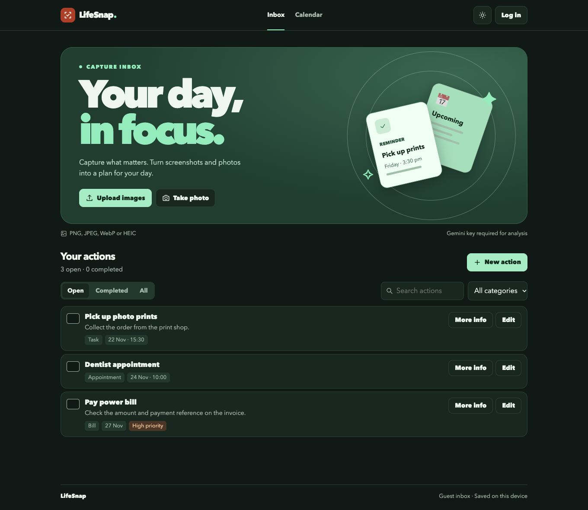
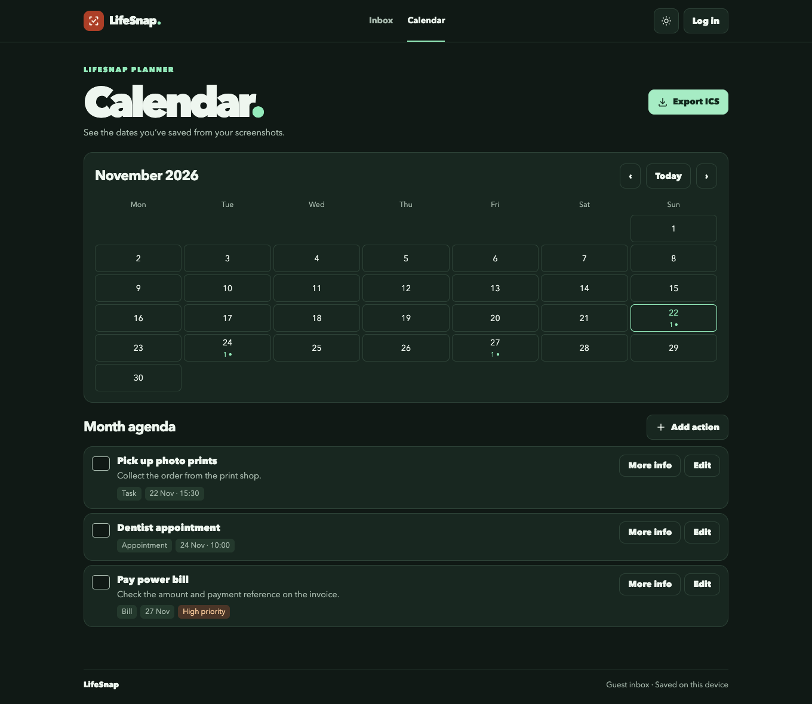

# LifeSnap

LifeSnap turns screenshots and camera photos into editable actions. It includes an inbox with search, category and completion filters, a monthly calendar and agenda, and individual or bulk calendar downloads.

## Screenshots

The desktop app is shown in dark mode with LifeSnap’s built-in sample actions.

### Inbox

Upload screenshots or photos, then search, filter, and edit the actions you save.

### Calendar

See dated actions in the monthly calendar and agenda, and export them to an ICS file.

## Run locally

1. Install [Node.js](https://nodejs.org/) 22 or newer.
2. Open Terminal in the LifeSnap folder and run `npm ci`, then `npm start`.
3. Open [LifeSnap on localhost](http://localhost:3000). Choose **Load sample actions** to try the inbox and calendar without a Gemini key.

## Enable Gemini

Create a key in [Google AI Studio](https://aistudio.google.com/apikey). Copy `.env.example` to `.env` in the LifeSnap folder, then set `GEMINI_API_KEY` in that file and restart the server. The default model is `gemini-3.5-flash-lite`. Override `GEMINI_MODEL` with a [Gemini model](https://aistudio.google.com/docs/models) that supports image input and structured output and is available to your key.

Choose **Upload images** or **Take photo**, check the previews, then select **Analyse images**. LifeSnap sends each image to Gemini and presents the extracted actions for review. Edit any uncertain details, then save the suggestions you want to keep. Failed images remain in the queue for retry.

The server reads the key from the environment. Inbox entries and their source images are saved to IndexedDB in the current browser and origin. Exported all-day dates stay as calendar dates. Timed exports use floating times so the clock time is preserved in the importing calendar’s local timezone. The calendar shows open, dated actions. You can also export a completed action individually from its editor.

## Use on a phone

Serve the app from an HTTPS URL reachable by the phone. For a private deployment, run `npm start` on a Node host behind an HTTPS reverse proxy and restrict access to authorised users at the proxy before enabling Gemini. Set `HOST=0.0.0.0` if your host requires a non-loopback listener. The default bind address only accepts connections from the same machine.

On iPhone, open the HTTPS URL in Safari and choose **Share → Add to Home Screen**. On Android, use the browser menu’s install option where available. **Take photo** uses the browser’s native capture picker when supported. If the picker opens files instead, use the photo library to select a picture. The inbox and calendar are available offline after the app shell finishes caching. Gemini analysis requires a connection.

Each browser profile and origin has its own inbox. Keep the same URL to access saved actions. Clearing site data removes the local inbox and saved images.

### Quick iPhone test over Wi-Fi

On a trusted Wi-Fi network, connect your Mac and iPhone to the same Wi-Fi. Change the existing `HOST` line in your local `.env` to `HOST=0.0.0.0`, then restart LifeSnap. On your Mac, go to **System Settings → Wi-Fi → Details → TCP/IP** and find its IPv4 address. On the iPhone, open `http://MAC_IP:3000` in Safari, replacing `MAC_IP` with that address. Keep the Mac and LifeSnap server running. On the iPhone, `localhost` refers to the iPhone itself.

Local HTTP is for a quick test. Use HTTPS for the offline PWA service worker and when sending sensitive screenshots. The Wi-Fi address and localhost have separate inboxes. Set `HOST=127.0.0.1` again when finished to restrict access to the Mac.

### Screenshot and web sources

Up to three images are scanned in parallel. Action cards show which image they came from and the editor opens the original. Use **Look up public information** inside an action editor to ask a separate Google Search question and see highlighted links for the sources Gemini cites. The answer stays in that editor session. Google Search grounding may require billing or separate quota.

## Enable Firebase accounts and cloud inboxes

1. In [Firebase Console](https://console.firebase.google.com/), create or select a project, then register a **Web app** in Project settings.
2. Under **Authentication → Sign-in method**, enable **Email/Password**.
3. Under **Firestore Database**, create the default database in production mode. Select a location suitable for your users. In the database's **Rules** tab, paste the contents of `firestore.rules` and publish them. Or run `firebase deploy --only firestore:rules --project YOUR_PROJECT_ID` with the Firebase CLI.
4. In your existing LifeSnap `.env`, add `FIREBASE_API_KEY`, `FIREBASE_PROJECT_ID`, and `FIREBASE_APP_ID` from the registered web app's `apiKey`, `projectId`, and `appId`. Keep the Gemini settings already in the file. The Firebase web settings are public configuration. Service-account credentials are unnecessary.
5. Restart LifeSnap. Choose **Log in → Sign up**. Each signed-in user has a private Firestore inbox. Existing local actions stay in the guest inbox. To bring them into your account, choose **Account → Copy guest actions**. Signed-in actions sync across devices, including source image previews. Large source images may be compressed before syncing.

For account use on a phone, serve LifeSnap over HTTPS. Guest mode remains available without Firebase. The scan overview opens after images are selected, and closing it lets the scan continue. Select the compact overview in the inbox to return. The theme button switches between dark and light.

## QR inspection and Google sign-in

After selecting an image, choose **Analyse images** to decode QR codes on the LifeSnap server and extract actions with Gemini. Choose **QR only** to skip sending the image to Gemini. The progress bar tracks completed images. QR results show the decoded payload and, for web addresses, the domain and protocol. LifeSnap never opens the address, fetches the site, or activates the payload. The **More info** button next to an extracted action opens a suggested public search question that you can edit before sending.

To enable Google sign-in, open **Authentication → Sign-in method → Add new provider → Google** in Firebase. Enable the provider, choose the support email and public-facing project name, then save. Under **Authentication → Settings → Authorized domains**, add the hostname where you serve LifeSnap. Use `localhost` for Mac development and an authorised HTTPS hostname for phone sign-in. A plain HTTP hotspot address is suitable for testing the QR and inbox interface. **Continue with Google** creates an account on the first successful sign-in.
